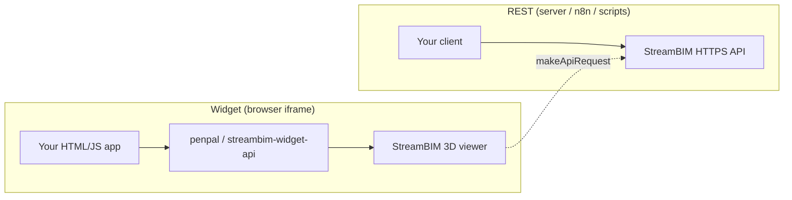

# StreamBIM API: agent guide

This repository is **unofficial** StreamBIM API documentation for programmatic and agentic
use, plus a harness that lets you drive a live StreamBIM viewer. Each file under `api/` is
self-contained; everything under `widget/` was verified against app.streambim.com.

## What to read

| Goal | Start here |
|------|------------|
| Build a **widget** (iframe inside StreamBIM) | [widget/README.md](widget/README.md) (verified, one page per method in `widget/methods/`), then copy [examples/minimal-widget](examples/minimal-widget/index.html). Background: [api/widget-api.md](api/widget-api.md) (official SDK summary, ecosystem repos) |
| Configure **contextual links** (sources / lookups / query params) | [api/widget-config.md](api/widget-config.md): per-project JSON, ties to IFC properties |
| Automate **projects, topics, IFC, sync** from a backend | [api/README.md](api/README.md) → [api/authentication.md](api/authentication.md) → relevant REST section |
| **Call REST from a widget** (`makeApiRequest`) | [widget/guides/rest-api-from-widgets.md](widget/guides/rest-api-from-widgets.md) + [api/ifc-searches.md](api/ifc-searches.md) |
| **Checklists**, colour by answers | [widget/guides/checklists-and-colour-by-value.md](widget/guides/checklists-and-colour-by-value.md) |
| **BCF / collaboration** | [api/bcf.md](api/bcf.md), [api/topics.md](api/topics.md) |
| **Generative UI** in the widget | [openui/README.md](openui/README.md) |

## Widget vs REST API



- **Widget API**: control the **live 3D viewer** (pick, highlight, camera, searches in-scene). Requires the **WIDGET** project feature and URL whitelisting.
- **REST API**: CRUD on projects, documents, converter jobs, topics, etc. Uses Bearer tokens from [authentication.md](api/authentication.md), or the user's session via `makeApiRequest` inside a widget.

Use the widget API when the user must **see or interact with the model**. Use REST for
**batch jobs, integrations or ETL** without an embedded viewer.

## Minimal widget bootstrap (verified)

The official helper's `StreamBIM.connectToParent(window, …)` **fails inside StreamBIM**: it
builds its allowed origin from `document.referrer`, which is empty there (`Invalid URL`), and
passing `window` points penpal at the widget itself. Connect with penpal v7 directly; it's the
same handshake:

```javascript
import { WindowMessenger, connect } from 'penpal'; // or the UMD build: window.Penpal

const messenger = new WindowMessenger({
  remoteWindow: window.parent,
  allowedOrigins: [location.ancestorOrigins?.[0] || /^https:\/\/([a-z0-9-]+\.)?streambim\.com$/],
});
const api = await connect({
  messenger,
  methods: { pickedObject: ({ guid, point }) => console.log(guid, point) },
  timeout: 20000,
}).promise;

const projectId = await api.getProjectId();
```

Embedded mode (StreamBIM in *your* iframe) uses the official helper, which works there because
the iframe `src` gives the origin. Not re-verified in this repo:

```javascript
const iframe = document.getElementById('streambim');
iframe.src = `https://app.streambim.com/webapp/default/#/viewer?projectId=${PROJECT_ID}&embedded=true`;

await StreamBIM.connectToChild(iframe, { pickedObject: (r) => console.log(r.guid) });
await StreamBIM.API.setNavigationMode(1);
```

**Official source:** [github.com/streambim/streambim-widget-api](https://github.com/streambim/streambim-widget-api) (master ≈ v3.0.0). Demos: `demo_embedded/`, `demo_2/`, `demo_window/`.

## Traps (verified on app.streambim.com, 2026-11-01)

- Rejections are `{ code, debug }` (the official README says `detail`).
- `setCameraPosition`, `deHighlightAllObjects` and `applyStyles` never resolve; `deHighlightObject` always rejects.
- Custom colours render for spaces (`colorCodeSpaces`). Objects take custom colours only in the `taskctrl` flavour (`colorCodeObjectsWithLegends`); see [flavours](widget/README.md#flavours).
- `makeApiRequest` reports 201/204 as `DataCloneError` even when the write succeeded.
- Full list: [corrections to the official README](widget/README.md#corrections-to-the-official-readme).

## Live viewer access (harness)

If the user runs `cd harness && npm start` and opens a project with the `localhost` widget, the
`streambim` MCP server (see `.mcp.json`) gives you `streambim_execute_js`, `streambim_rest`,
`streambim_screenshot`, `streambim_render_openui` and docs search. Call `streambim_status`
first. See [harness/README.md](harness/README.md).

## Editing this repo

- `widget/methods/`, `widget/guides/`, `widget/README.md` and `widget/events.md` are **generated**.
  Edit `widget/spec/*.mjs`, verify with `npm run verify -- --only <name>` in `harness/`, then
  `npm run build-docs`.
- `api/` is plain markdown.
- Code style: plain ES modules, no build step, no framework in widgets.

## Before shipping a widget

1. Contact **support@rendra.io**: whitelist the widget URL and enable **WIDGET** on the project.
2. Call `api.*` only **after** the connection promise resolves.
3. Use `makeApiRequest` for REST endpoints not exposed on the widget API.
4. List it on the community marketplace when ready: [streambim-marketplace.vercel.app](https://streambim-marketplace.vercel.app/?widget=true).

## Related repos

See **Widget ecosystem** in [api/widget-api.md](api/widget-api.md#widget-ecosystem--github-connections) for an inventory of GitHub repos tied to the widget API.
