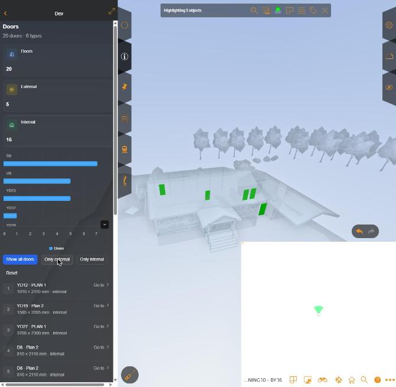

# Example widgets

Standalone StreamBIM widgets: plain HTML, no build step, no agent needed. Copy one as the
starting point for your own. All three were run against app.streambim.com on 2026-11-01.

| Example | Shows |
|---|---|
| [`minimal-widget/`](minimal-widget/index.html) | Connecting, project info, reacting to clicks in 3D (`pickedObject` → `getObjectInfo`), highlighting doors, **colouring rooms with your own colours** per floor, screenshots |
| [`checklist-colors/`](checklist-colors/index.html) | Reading checklists over REST, grouping objects by checklist answer, colouring rooms (any flavour) or objects (taskctrl flavour) with a clickable legend, and falling back to per-value isolation where colours aren't available |
| [`openui-dashboard/`](openui-dashboard/index.html) | Building an [OpenUI](https://www.openui.com) dashboard from a door query (cards, chart, list) whose buttons drive the viewer. See [openui/](../openui/README.md) |



## Run one

StreamBIM's `localhost` widget loads `http://localhost:3000/`. The harness can serve any folder there:

```bash
cd harness
npm install                                   # once; also copies penpal + OpenUI to /vendor/
npm run example -- ../examples/checklist-colors
```

Open your project with the widget (`…/#/viewer/objectinfo/widget/localhost?projectId=<id>`) and
reload the panel after edits. Each example shows errors in the panel itself, and the full
console is in DevTools under the `localhost` frame.

The examples load `/vendor/penpal.min.js` (and `/vendor/openui/…`) from the harness. Outside the
harness, use the CDN builds instead:
`https://cdn.jsdelivr.net/npm/penpal@7.0.6/dist/penpal.min.js`,
`https://cdn.jsdelivr.net/npm/@openuidev/browser-bundle@0.2.1/dist/openui-bundle.min.js` and
`…/openui-styles.css`.

## Ship one

A widget is just a web page. To use yours without the localhost setup, host it on HTTPS and
ask Rendra (`support@rendra.io`) to register it as a widget for your project. The connection
code in these examples works unchanged.

## The connection pattern used in all examples

```js
const messenger = new Penpal.WindowMessenger({
  remoteWindow: window.parent,
  allowedOrigins: [location.ancestorOrigins?.[0] || /^https:\/\/([a-z0-9-]+\.)?streambim\.com$/],
});
const api = await Penpal.connect({ messenger, methods: { /* event callbacks */ }, timeout: 20000 }).promise;
```

Then call any [widget API method](../widget/README.md#methods): `await api.getFloors()`. Events you
can pass in `methods` are listed in [events.md](../widget/events.md).
