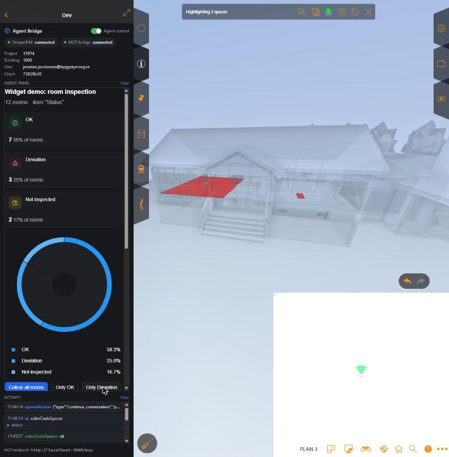

# OpenUI in the StreamBIM widget

Agents connected to the harness can render **generative UI** in the widget pane with
[OpenUI](https://www.openui.com) (Thesys, MIT). The agent writes **OpenUI Lang**, a compact
line-based language, and the widget renders it with OpenUI's built-in component library:
cards, metric cards, tables, charts, forms, tabs, buttons and so on (84 components). Buttons
can drive the StreamBIM viewer directly, or report back to the agent.



*The dashboard from [`harness/tools/demo-openui-checklist.mjs`](../harness/tools/demo-openui-checklist.mjs), built from the
room checklist in project 15974. "Only Deviation" isolates the three deviation rooms in the
viewer; the click also reaches the agent as an `openuiAction` event.*

## Tools

| MCP tool | What it does |
|---|---|
| `streambim_openui_spec` | Returns the component catalog and the full OpenUI Lang system prompt (also saved as [system-prompt.md](system-prompt.md)). Read it before writing OpenUI. |
| `streambim_render_openui` | Renders an OpenUI Lang program in the widget pane. `append: true` adds statements to the current program; `streamMs` reveals it line by line like a streaming LLM response. |
| `streambim_get_events` with `names: ["openuiAction"]` | Button clicks and other actions from the rendered UI. Pass `waitMs` to wait for the user. |

The bundle (`@openuidev/browser-bundle` 0.2.1: React, the renderer and the component library;
3.2 MB JS + 0.4 MB CSS) is vendored in `harness/widget/vendor/openui/` (copied there by `npm install`) and only loaded the first time
OpenUI is rendered. It makes no network calls of its own.

## OpenUI Lang in 30 seconds

```
root = Card([header, stats, actions])
header = CardHeader("Door inspection", "20 doors")
stats = OverviewCardBlock([ok, dev], "grid")
ok = OverviewCardItem("ok", IconText(Icon("circle-check"), "success", "s", "OK"), MetricIndicatorInline("14"))
dev = OverviewCardItem("dev", IconText(Icon("triangle-alert"), "danger", "s", "Deviation"), MetricIndicatorInline("4"))
actions = Buttons([showDev])
showDev = Button("Show deviations", @ToAssistant("Show deviations", {streambim: {method: "applyObjectSearch", args: [{key: "@kind", value: "Door"}]}}))
```

One statement per line, `root` is the entry point (root component: `Card`), references may come
before their definitions (write `root` first so the shell appears immediately while streaming).
Full rules and every component signature: [system-prompt.md](system-prompt.md).

## Driving the viewer from OpenUI buttons

OpenUI's built-in actions are `@ToAssistant(message, context?)` and `@OpenUrl(url)`. The widget
recognises two viewer-call conventions on top of them and runs the call in the StreamBIM viewer:

| Form | Example |
|---|---|
| `@ToAssistant` with `context.streambim` (easiest for LLMs) | `@ToAssistant("Go to door", {streambim: {method: "gotoObject", args: ["048mvnhWPDHefuPHQ5uMBr"]}})` |
| `@OpenUrl` with a `streambim://` URL | `@OpenUrl("streambim://gotoObject/048mvnhWPDHefuPHQ5uMBr")`, each path segment is one argument, URL-encoded, JSON-parsed when it looks like JSON |

`method` is any [widget API method](../widget/README.md#methods), so a button can colour spaces,
search, isolate, go to objects, take screenshots and so on. The result (or error) is attached to
the `openuiAction` event, so the agent sees what happened.

Every other action is only forwarded to the agent:

```json
{
  "name": "openuiAction",
  "data": {
    "type": "continue_conversation",
    "params": { "context": { "streambim": { "method": "colorCodeSpaces", "args": [{ "0A0a…QP": "#e5484d" }] } } },
    "humanFriendlyMessage": "Only Deviation",
    "formState": {},
    "formName": null,
    "result": true
  }
}
```

(Observed event for the "Only Deviation" click above.) `FollowUpItem`s and buttons without an
action send their label as `humanFriendlyMessage`; forms include their values in `formState`.
An agent can loop: render UI → `streambim_get_events({names: ["openuiAction"], waitMs: 60000})`
→ act → re-render.

## Limits (observed 2026-11-01)

- The UI renders in the **widget pane**. The StreamBIM page is a different origin, so nothing
  can be drawn on top of the 3D canvas itself; the pane can be widened with the expand button
  (`setExpanded(true)` where supported).
- Charts use OpenUI's fallback palette (shades of blue): the browser bundle does not expose the
  theme provider that sets `defaultChartPalette`. Use `IconText`/`Tag` variants
  (`success`, `danger`, `warning`, ...) when colours carry meaning.
- Only the built-in library is available: the browser bundle does not expose `createLibrary`,
  so custom components (or custom `@Name` actions) need a custom bundle.
- The widget pane is narrow (~420 px), so grids collapse to one column.
