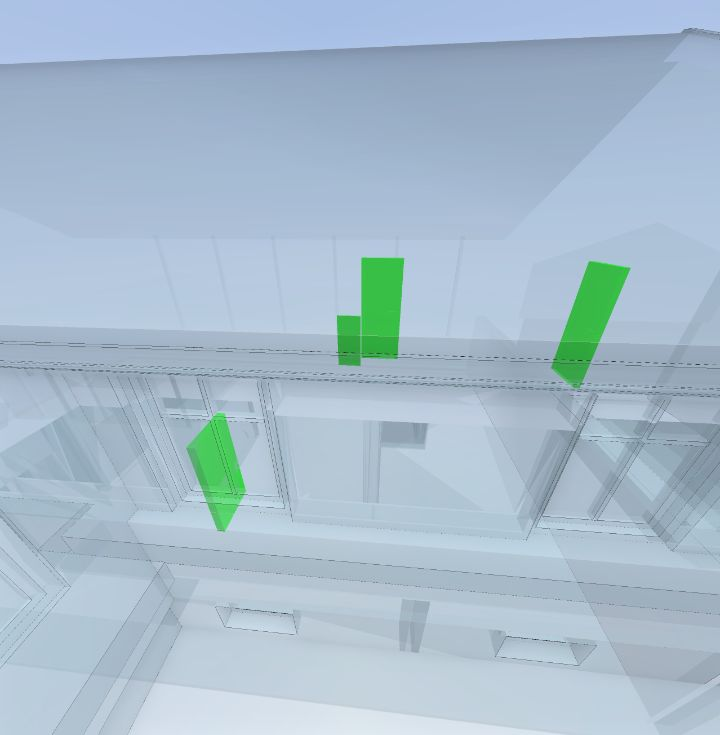
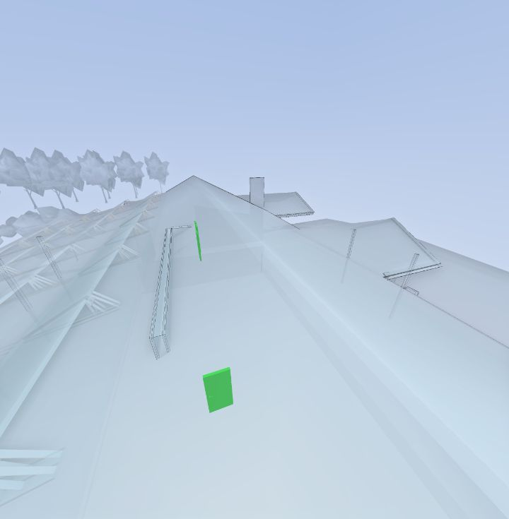

# Checklists from a widget, and colouring objects by checklist values

[Widget API docs](../README.md)

StreamBIM checklists attach questions (checklist items) to model objects. Every object × item pair is a **checklist item instance** that holds the answer. Through `makeApiRequest` a widget can read all of it, and also create checklists and fill in answers.

**What StreamBIM can't do today:** colour the model by the *value* of a checklist item. The viewer's own checklist colouring is by status only (`done` / `mixed` / `open`). This guide shows how a widget can do it: read the values, group the objects per value, give each value a colour and a legend, and let the user isolate one value at a time.

> Where custom colours render (verified 2026-11-01):

| Target | Default flavour (`/webapp/default/`) | `taskctrl` flavour (`/webapp/taskctrl/#/…&forceFlavor=true`) |
|---|---|---|
| Spaces | ✅ `colorCodeSpaces(guid → colour)` | ✅ also `colorCodeSpacesWithLegends` |
| Other objects | ❌ `colorCodeObjects` draws search green | ✅ `colorCodeObjectsWithLegends({ data, legends })`, with StreamBIM's own legend |

So a space-based checklist gets real colours everywhere. An object checklist (like the doors here) gets real colours in taskctrl. In default it gets the legend and per-value isolation recipe below.

Examples marked as writing data were run on the demo project (`--include-writes`). The others read the demo checklist "Widget demo: door inspection" (20 doors, one single-select item "Status" with options OK / Deviation / Not inspected).

## Data model

| JSON:API type (`/project-{id}/api/v1/v2/…`) | What | Key fields |
|---|---|---|
| `checklists` | The checklist | `name`, `is-draft`, `group-by` (`""` = per object; `"space"`, `"floor"`, `"TAKT~Navn"`… = grouped); relationships `ifc-query` (which objects get it), `workflow` (permissions + statuses), `checklist-items`, `buildings` |
| `checklist-items` | A question | `title`, `input-type` (`checkbox`, `text`, `singleselect`, …), `order`, `is-draft`; relationship `item-options` |
| `checklist-options` | A choice for select items | `name`. The instance stores the option **id** |
| `checklist-item-instances` | The answer for one object | `options` (option id for select items), `option-number`, `option-date`, `title` (object name); relationships `object` (`ifc-light-objects`, the GUID), `checklist-item`, `checklist`, `status` |
| `ifc-queries` | Saved search defining the objects | `rules` (same shape as `ifc-searches`), `search-id` |
| `workflows` (type `checklist`) | Who can see / fill / sign | statuses `open` (2000), `done` (3000), `closed` (4000), `notRelevant` (4500) |

Instances are **created by the server** when the checklist's `ifc-query` (with a `search-id`) matches objects. You don't POST them (POST answers 500). You PATCH the generated ones.

## Read checklists, items and options

#### The demo checklist, its item and options

```js
const projectId = await StreamBIM.API.getProjectId();
const buildingId = await StreamBIM.API.getBuildingId();
const v2 = '/project-' + projectId + '/api/v1/v2/';
const isCloneError = (err) => /could not be cloned/.test(err && err.message);
async function get(path) {
  const sep = path.includes('?') ? '&' : '?';
  return JSON.parse(await StreamBIM.API.makeApiRequest({ url: v2 + path + sep + '_=' + Date.now() })).data;
}
// POST, then find the new record: the 201 response never reaches the widget.
async function create(type, attributes, relationships, find) {
  try {
    await StreamBIM.API.makeApiRequest({ url: v2 + type, method: 'POST', body: { data: { type, attributes, relationships } } });
  } catch (err) {
    if (!isCloneError(err)) throw err;
  }
  const record = await find();
  if (!record) throw new Error('POST ' + type + ' failed');
  return record;
}
// PATCH with the full current record: partial PATCHes were not applied.
async function patch(type, id, changes = {}, relChanges = {}) {
  const cur = await get(type + '/' + id);
  const body = { data: { id, type, attributes: { ...cur.attributes, ...changes }, relationships: { ...cur.relationships, ...relChanges } } };
  return JSON.parse(await StreamBIM.API.makeApiRequest({ url: v2 + type + '/' + id, method: 'PATCH', body })).data;
}
const newest = (list) => list.sort((a, b) => Number(b.id) - Number(a.id))[0];

const checklist = newest((await get('checklists')).filter((c) => c.attributes.name === 'Widget demo: door inspection'));
const items = await get('checklist-items?filter[checklist]=' + checklist.id);
const options = Object.fromEntries((await get('checklist-options')).map((o) => [o.id, o.attributes.name]));
return {
  checklist: { id: checklist.id, name: checklist.attributes.name, instancesTotal: checklist.attributes['instances-total'], query: checklist.relationships['ifc-query'].data },
  items: items.map((i) => ({ id: i.id, title: i.attributes.title, inputType: i.attributes['input-type'], options: i.relationships['item-options'].data.map((o) => options[o.id]) })),
};
```

<details open><summary>Output (verified 2026-11-01, 353 ms)</summary>

```json
{
  "checklist": {
    "id": "1632",
    "name": "Widget demo: door inspection",
    "instancesTotal": 20,
    "query": {
      "id": "133",
      "type": "ifc-query"
    }
  },
  "items": [
    {
      "id": "3264",
      "title": "Status",
      "inputType": "singleselect",
      "options": [
        "OK",
        "Deviation",
        "Not inspected"
      ]
    }
  ]
}
```

</details>

## Create a checklist and assign it to objects (API only)

The order matters:

1. `POST /ifc-searches` with the rules → `searchId`.
2. `POST /v2/ifc-queries` with `rules` **and** `search-id`. Without `search-id` no instances are generated.
3. `POST /v2/checklists` (draft), then options, then items.
4. Full-record `PATCH` of the checklist to set `ifc-query`. The server then creates one instance per object × item, and gives the checklist its own `checklist` workflow if you didn't pass one.
5. A second `PATCH` with `is-draft: false` to publish.

Every POST answers 201, which the widget sees as a `DataCloneError`. The `create()` helper ignores that and finds the new record by a unique value. This example deletes what it created at the end.

#### Create, assign to windows, check instances, delete

```js
const projectId = await StreamBIM.API.getProjectId();
const buildingId = await StreamBIM.API.getBuildingId();
const v2 = '/project-' + projectId + '/api/v1/v2/';
const isCloneError = (err) => /could not be cloned/.test(err && err.message);
async function get(path) {
  const sep = path.includes('?') ? '&' : '?';
  return JSON.parse(await StreamBIM.API.makeApiRequest({ url: v2 + path + sep + '_=' + Date.now() })).data;
}
// POST, then find the new record: the 201 response never reaches the widget.
async function create(type, attributes, relationships, find) {
  try {
    await StreamBIM.API.makeApiRequest({ url: v2 + type, method: 'POST', body: { data: { type, attributes, relationships } } });
  } catch (err) {
    if (!isCloneError(err)) throw err;
  }
  const record = await find();
  if (!record) throw new Error('POST ' + type + ' failed');
  return record;
}
// PATCH with the full current record: partial PATCHes were not applied.
async function patch(type, id, changes = {}, relChanges = {}) {
  const cur = await get(type + '/' + id);
  const body = { data: { id, type, attributes: { ...cur.attributes, ...changes }, relationships: { ...cur.relationships, ...relChanges } } };
  return JSON.parse(await StreamBIM.API.makeApiRequest({ url: v2 + type + '/' + id, method: 'PATCH', body })).data;
}
const newest = (list) => list.sort((a, b) => Number(b.id) - Number(a.id))[0];

const rules = [[{ propKey: '@kind', propValue: 'Window', buildingId }]];
const { searchId } = JSON.parse(await StreamBIM.API.makeApiRequest({ url: '/project-' + projectId + '/api/v1/ifc-searches', method: 'POST', contentType: 'application/json', body: { rules } }));
const query = await create('ifc-queries', { name: '', rules, 'search-id': searchId }, undefined,
  async () => newest((await get('ifc-queries')).filter((q) => q.attributes['search-id'] === searchId)));

const name = 'Widget API test ' + Date.now();
const checklist = await create('checklists', { name, 'group-by': '', 'is-draft': true }, {
  buildings: { data: [{ id: buildingId, type: 'buildings' }] },
}, async () => (await get('checklists')).find((c) => c.attributes.name === name));

const option = await create('checklist-options', { name: name + ' / OK' }, undefined,
  async () => (await get('checklist-options')).find((o) => o.attributes.name === name + ' / OK'));
const item = await create('checklist-items', { title: 'Checked', 'input-type': 'singleselect', 'item-type': 'item', order: 0, 'is-draft': false }, {
  checklist: { data: { id: checklist.id, type: 'checklists' } },
  'item-options': { data: [{ id: option.id, type: 'checklist-options' }] },
}, async () => (await get('checklist-items?filter[checklist]=' + checklist.id))[0]);

await patch('checklists', checklist.id, {}, { 'ifc-query': { data: { id: query.id, type: 'ifc-queries' } } }); // assign
await patch('checklists', checklist.id, { 'is-draft': false }); // publish
const after = await get('checklists/' + checklist.id);
const instances = await get('checklist-item-instances?page[limit]=500&filter[checklist]=' + checklist.id);

let deleted;
try {
  await StreamBIM.API.makeApiRequest({ url: v2 + 'checklists/' + checklist.id, method: 'DELETE' });
  deleted = 'ok';
} catch (err) {
  deleted = isCloneError(err) ? 'ok (204, reported as clone error)' : err.message;
}
const stillListed = (await get('checklists')).some((c) => c.id === checklist.id);
// DELETE answers 204 for these, which also arrives as a clone error.
for (const path of ['checklist-options/' + option.id, 'ifc-queries/' + query.id]) {
  await StreamBIM.API.makeApiRequest({ url: v2 + path, method: 'DELETE' }).catch((err) => { if (!isCloneError(err)) throw err; });
}
return { queryId: query.id, checklistId: checklist.id, itemId: item.id, workflow: after.relationships.workflow.data, isDraft: after.attributes['is-draft'], instancesTotal: after.attributes['instances-total'], instancesListed: instances.length, deleted, stillListed };
```

<details open><summary>Output (verified 2026-11-01, 1506 ms)</summary>

```json
{
  "queryId": "140",
  "checklistId": "1637",
  "itemId": "3269",
  "workflow": {
    "id": "2639",
    "type": "workflows"
  },
  "isDraft": true,
  "instancesTotal": 0,
  "instancesListed": 31,
  "deleted": "ok",
  "stillListed": false
}
```

</details>

## Fill in answers

PATCH each generated instance with the option id (full record, see the helper). Here the answers are set deterministically so the colour example below has three groups.

#### Answer the demo checklist for all 20 doors

```js
const projectId = await StreamBIM.API.getProjectId();
const buildingId = await StreamBIM.API.getBuildingId();
const v2 = '/project-' + projectId + '/api/v1/v2/';
const isCloneError = (err) => /could not be cloned/.test(err && err.message);
async function get(path) {
  const sep = path.includes('?') ? '&' : '?';
  return JSON.parse(await StreamBIM.API.makeApiRequest({ url: v2 + path + sep + '_=' + Date.now() })).data;
}
// POST, then find the new record: the 201 response never reaches the widget.
async function create(type, attributes, relationships, find) {
  try {
    await StreamBIM.API.makeApiRequest({ url: v2 + type, method: 'POST', body: { data: { type, attributes, relationships } } });
  } catch (err) {
    if (!isCloneError(err)) throw err;
  }
  const record = await find();
  if (!record) throw new Error('POST ' + type + ' failed');
  return record;
}
// PATCH with the full current record: partial PATCHes were not applied.
async function patch(type, id, changes = {}, relChanges = {}) {
  const cur = await get(type + '/' + id);
  const body = { data: { id, type, attributes: { ...cur.attributes, ...changes }, relationships: { ...cur.relationships, ...relChanges } } };
  return JSON.parse(await StreamBIM.API.makeApiRequest({ url: v2 + type + '/' + id, method: 'PATCH', body })).data;
}
const newest = (list) => list.sort((a, b) => Number(b.id) - Number(a.id))[0];

const checklist = newest((await get('checklists')).filter((c) => c.attributes.name === 'Widget demo: door inspection'));
const [item] = await get('checklist-items?filter[checklist]=' + checklist.id);
const optionIds = Object.fromEntries((await get('checklist-options')).filter((o) => item.relationships['item-options'].data.some((x) => x.id === o.id)).map((o) => [o.attributes.name, o.id]));
const instances = await get('checklist-item-instances?page[limit]=500&filter[checklist]=' + checklist.id);
const answer = (i) => (i % 5 === 0 ? 'Deviation' : i % 7 === 0 ? 'Not inspected' : 'OK');
const written = {};
for (const [i, inst] of instances.entries()) {
  const saved = await patch('checklist-item-instances', inst.id, { options: optionIds[answer(i)] });
  written[saved.attributes.options] = (written[saved.attributes.options] || 0) + 1;
}
return { optionIds, instances: instances.length, writtenPerOptionId: written };
```

<details open><summary>Output (verified 2026-11-01, 2504 ms)</summary>

```json
{
  "optionIds": {
    "Deviation": "5",
    "Not inspected": "6",
    "OK": "4"
  },
  "instances": 20,
  "writtenPerOptionId": {
    "4": 14,
    "5": 4,
    "6": 2
  }
}
```

</details>

## Read answers per object

The checklist export gives one row per object with every item's answer (`"<order>. <title>": <option id>`). It needs a base64 `query` parameter.

#### Export answers

```js
const projectId = await StreamBIM.API.getProjectId();
const v2 = '/project-' + projectId + '/api/v1/v2/';
const checklists = JSON.parse(await StreamBIM.API.makeApiRequest({ url: v2 + 'checklists' })).data;
const checklist = checklists.filter((c) => c.attributes.name === 'Widget demo: door inspection').sort((a, b) => b.id - a.id)[0];
const query = { key: 'object', sort: { field: 'title', descending: false }, page: { skip: 0, limit: 10000 }, filter: { checklist: checklist.id }, timeZone: 'Europe/Stockholm', format: 'json', filename: '' };
const res = JSON.parse(await StreamBIM.API.makeApiRequest({
  url: '/project-' + projectId + '/api/v1/checklists/export/json/?query=' + encodeURIComponent(btoa(JSON.stringify(query))),
  accept: 'application/json',
}));
return { total: res.meta.total, first: res.data.slice(0, 2) };
```

<details open><summary>Output (verified 2026-11-01, 296 ms)</summary>

```json
{
  "total": 20,
  "first": [
    {
      "object": "2uYU4y7nP7g9mgpu4mkkNO",
      "name": "Cased Opening:ÖK10:2731493",
      "title": "Cased Opening:ÖK10:2731493",
      "status": "not started",
      "floor": "Plan 2",
      "spaces": "17, 10, Area:2737579",
      "system": "",
      "ifcType": "Door",
      "topicsTotal": 0,
      "topicsOpen": 0,
      "topicsClosed": 0,
      "closedDate": null,
      "building": "<no name>",
      "items": {
        "1. Status": "4"
      }
    },
    {
      "object": "1NE2FAfsz5kedhy_IXrbxf",
      "name": "Doors_Door-Sets_Diplomat_Elvira-Glass-double-door:21Mx16M:2680668",
      "title": "Doors_Door-Sets_Diplomat_Elvira-Glass-double-door:21Mx16M:2680668",
      "status": "not started",
      "floor": "PLAN 2",
      "spaces": "Area:2737585",
      "system": "",
      "ifcType": "Door",
      "topicsTotal": 0,
      "topicsOpen": 0,
      "topicsClosed": 0,
      "closedDate": null,
      "building": "<no name>",
      "items": {
        "1. Status": "4"
      }
    }
  ]
}
```

</details>

## Colour by checklist item value (widget recipe)

The coordinated flow a widget can run:

1. Load the checklist item and its options, to map option id to name.
2. Export the answers and group object GUIDs per value.
3. Give each value a colour, call `colorCodeObjects` with the full map, and draw a legend with counts in the widget.
4. On a legend click, call `colorCodeObjects` with only that value's objects. This isolates them (other objects follow the search visualization mode) and zooms to them.

#### Build the colour map and legend

```js
const projectId = await StreamBIM.API.getProjectId();
const v2 = '/project-' + projectId + '/api/v1/v2/';
const getJson = async (url, accept) => JSON.parse(await StreamBIM.API.makeApiRequest(accept ? { url, accept } : { url }));

async function checklistValueGroups(checklistName, itemTitle) {
  const checklist = (await getJson(v2 + 'checklists')).data.filter((c) => c.attributes.name === checklistName).sort((a, b) => b.id - a.id)[0];
  const item = (await getJson(v2 + 'checklist-items?filter[checklist]=' + checklist.id)).data.find((i) => i.attributes.title === itemTitle);
  const optionName = Object.fromEntries((await getJson(v2 + 'checklist-options')).data.map((o) => [o.id, o.attributes.name]));
  const query = { key: 'object', page: { skip: 0, limit: 10000 }, sort: { field: 'title', descending: false }, filter: { checklist: checklist.id }, format: 'json', filename: '' };
  const rows = (await getJson('/project-' + projectId + '/api/v1/checklists/export/json/?query=' + encodeURIComponent(btoa(JSON.stringify(query))), 'application/json')).data;
  const column = item.attributes.order + 1 + '. ' + item.attributes.title;
  const groups = {};
  for (const row of rows) {
    const raw = row.items[column];
    const value = raw ? optionName[raw] || raw : 'No answer';
    (groups[value] = groups[value] || []).push(row.object);
  }
  return groups;
}

const PALETTE = { OK: '#30a46c', Deviation: '#e5484d', 'Not inspected': '#f5d90a', 'No answer': '#8b8d98' };
const groups = await checklistValueGroups('Widget demo: door inspection', 'Status');
const colors = {};
for (const [value, guids] of Object.entries(groups)) for (const g of guids) colors[g] = PALETTE[value] || '#3e63dd';
await StreamBIM.API.colorCodeObjects(colors);

// Legend in the widget page; click a row to isolate that value.
const legend = document.querySelector('#checklist-legend') || document.body.appendChild(Object.assign(document.createElement('div'), { id: 'checklist-legend' }));
legend.innerHTML = Object.entries(groups).map(([value, guids]) =>
  '<button data-value="' + value + '" style="display:flex;gap:8px;align-items:center;width:100%;margin:2px 0">' +
  '<span style="width:12px;height:12px;border-radius:3px;background:' + (PALETTE[value] || '#3e63dd') + '"></span>' + value + ' <b style="margin-left:auto">' + guids.length + '</b></button>').join('');
legend.onclick = async (e) => {
  const value = e.target.closest('button')?.dataset.value;
  if (!value) return;
  await StreamBIM.API.colorCodeObjects(Object.fromEntries(groups[value].map((g) => [g, PALETTE[value]])));
  await StreamBIM.API.zoomToSearchResult();
};

return Object.fromEntries(Object.entries(groups).map(([value, guids]) => [value, { color: PALETTE[value], count: guids.length, first: guids[0] }]));
```

<details open><summary>Output (verified 2026-11-01, 493 ms)</summary>

```json
{
  "OK": {
    "color": "#30a46c",
    "count": 14,
    "first": "2uYU4y7nP7g9mgpu4mkkNO"
  },
  "Deviation": {
    "color": "#e5484d",
    "count": 4,
    "first": "0FdTIYaE1DKvQpJiepvzQL"
  },
  "Not inspected": {
    "color": "#f5d90a",
    "count": 2,
    "first": "1OO1g5mfPB5P$hxiSHg6rh"
  }
}
```

</details>

#### Isolate one value (what a legend click does)

```js
const projectId = await StreamBIM.API.getProjectId();
const v2 = '/project-' + projectId + '/api/v1/v2/';
const checklist = JSON.parse(await StreamBIM.API.makeApiRequest({ url: v2 + 'checklists' })).data.filter((c) => c.attributes.name === 'Widget demo: door inspection').sort((a, b) => b.id - a.id)[0];
const deviationId = JSON.parse(await StreamBIM.API.makeApiRequest({ url: v2 + 'checklist-options' })).data.find((o) => o.attributes.name === 'Deviation').id;
const query = { key: 'object', page: { skip: 0, limit: 10000 }, sort: { field: 'title', descending: false }, filter: { checklist: checklist.id }, format: 'json', filename: '' };
const rows = JSON.parse(await StreamBIM.API.makeApiRequest({ url: '/project-' + projectId + '/api/v1/checklists/export/json/?query=' + encodeURIComponent(btoa(JSON.stringify(query))), accept: 'application/json' })).data;
const deviations = rows.filter((r) => r.items['1. Status'] === deviationId).map((r) => r.object);

await StreamBIM.API.goHome();
await StreamBIM.API.colorCodeObjects(Object.fromEntries(deviations.map((g) => [g, '#e5484d'])));
await StreamBIM.API.setSearchVisualizationMode('FADED');
await StreamBIM.API.zoomToSearchResult();
await new Promise((r) => setTimeout(r, 2500));
const shot = await StreamBIM.API.takeScreenshot();
await StreamBIM.API.colorCodeObjects({});
return shot;
```

<details open><summary>Output (verified 2026-11-01, 10774 ms)</summary>

```json
"[image #1 returned as image content]"
```



</details>

## Colour objects by checklist value (taskctrl flavour)

In the `taskctrl` flavour, `colorCodeObjectsWithLegends` colours **objects** with your own colours, and StreamBIM draws the legend at the bottom of the viewer. Open the project as:

`https://app.streambim.com/webapp/taskctrl/#/viewer/objectinfo/widget/<widget>?buildingId=…&projectId=…&forceFlavor=true`

`forceFlavor=true` goes inside the hash. Placed before the `#` it redirected to the default flavour. Why it works there and not in default: taskctrl's scene filter passes the legends table (`colorCodeByGuid.colorCoding`) to the 3D search. That satisfies the `COLOR_CODED` check, and the material manager paints each object from the GUID map.

This example only runs in the taskctrl flavour. In default it rejects with "Method `colorCodeObjectsWithLegends` is not found".

#### Doors coloured by their "Status" answer

```js
const projectId = await StreamBIM.API.getProjectId();
const v2 = '/project-' + projectId + '/api/v1/v2/';
const get = async (path) => JSON.parse(await StreamBIM.API.makeApiRequest({ url: v2 + path })).data;

const checklist = (await get('checklists')).filter((c) => c.attributes.name === 'Widget demo: door inspection').sort((a, b) => b.id - a.id)[0];
const item = (await get('checklist-items?filter[checklist]=' + checklist.id)).find((i) => i.attributes.title === 'Status');
const optionName = Object.fromEntries((await get('checklist-options')).map((o) => [o.id, o.attributes.name]));
const instances = await get('checklist-item-instances?page[limit]=1000&filter[checklist]=' + checklist.id);

// Group object GUIDs by answer.
const groups = {};
for (const inst of instances) {
  if (inst.relationships['checklist-item'].data.id !== item.id) continue;
  const value = optionName[inst.attributes.options] || 'No answer';
  (groups[value] = groups[value] || []).push(inst.relationships.object.data.id);
}

// GUID -> colour, plus label -> colour for StreamBIM's legend.
const PALETTE = { OK: '30a46c', Deviation: 'e5484d', 'Not inspected': 'f5d90a', 'No answer': '8b8d98' };
const data = {};
for (const [value, guids] of Object.entries(groups)) for (const g of guids) data[g] = PALETTE[value];
const legends = Object.fromEntries(Object.keys(groups).map((v) => [v, PALETTE[v]]));

await StreamBIM.API.resetObjectSearch();
await StreamBIM.API.goHome();
await StreamBIM.API.colorCodeObjectsWithLegends({ data, legends });
await StreamBIM.API.zoomToSearchResult();
await new Promise((r) => setTimeout(r, 3000));
return await StreamBIM.API.takeScreenshot();
```

<details open><summary>Output (verified 2026-11-01, 3815 ms)</summary>

```json
"[image #1 returned as image content]"
```



</details>

## What the viewer does natively (status only)

For comparison, this is the data behind StreamBIM's own "colour by checklist": `GET /octtree/colorcode` with `propKey=status` and `checklistId` or `checklistItemId`. It only ever returns status buckets.

#### Native status colour buckets

```js
const projectId = await StreamBIM.API.getProjectId();
const buildingId = await StreamBIM.API.getBuildingId();
const v2 = '/project-' + projectId + '/api/v1/v2/';
const checklist = JSON.parse(await StreamBIM.API.makeApiRequest({ url: v2 + 'checklists' })).data.filter((c) => c.attributes.name === 'Widget demo: door inspection').sort((a, b) => b.id - a.id)[0];
return JSON.parse(await StreamBIM.API.makeApiRequest({
  url: '/project-' + projectId + '/api/v1/octtree/colorcode?buildingId=' + buildingId + '&propKey=status&checklistId=' + checklist.id,
  accept: 'application/json',
}));
```

<details open><summary>Output (verified 2026-11-01, 241 ms)</summary>

```json
{
  "type": "map",
  "data": {
    "done": "7BBB3E",
    "mixed": "BBA23E",
    "open": "C14644"
  },
  "count": null,
  "sum": 0
}
```

</details>

## Observed limitations (2026-11-01)

- PATCHing an instance's `status` relationship to `done` (3000) was accepted, but the status stayed `open` and the export still says "not started". Answers (`options`) are saved. How the UI marks an instance done (signing) is not documented yet.
- Partial PATCHes (only the changed attributes) were not applied. Send the full record.
- The UI's "Assign checklist" re-saves the checklist from its own cache, which blanked the name set by the API. Set the name after assigning, or assign over the API.
- `POST /v2/checklist-item-instances` answers 500. Instances only come from the `ifc-query`.
- Publishing: `is-draft: false` stuck on the demo checklist, but on a checklist created and assigned in the same script it still read `true` afterwards. Instances were generated either way. `instances-total` on the checklist lags; count `/v2/checklist-item-instances?filter[checklist]=…` instead.
- `/v2/workflows` lists only topic workflows. Checklist workflows aren't listed, but are created automatically.
- After navigating the StreamBIM tab around (checklist pages, search) the viewer once ended up with a NaN camera: `getCameraState()` returned `null`s, screenshots were empty (`"data:,"`), and `setCameraState` didn't recover it. Reloading the page did.
