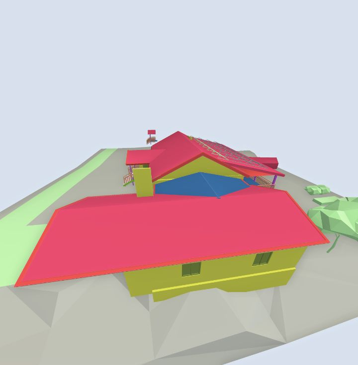

# colorCodeByProperty

**Status:** ✅ works · **Category:** Colour coding · [All methods](../README.md)

Let the viewer colour everything by the values of one property (its own palette and legend).

```ts
StreamBIM.API.colorCodeByProperty(opts?: { pset?: string, propertyKey?: string }): Promise<true>
```

## Parameters

| Name | Type | Required | Description |
|---|---|---|---|
| `opts.propertyKey` | `string` | no | Property to bucket by, e.g. `"@kind"`. |
| `opts.pset` | `string` | no | Property set name when the key lives in a pset. |

## Returns

`true`: Resolves before the colouring task finishes.

## What StreamBIM does

`viewerController.colorCodeIfcBy.perform(pset, propertyKey)` (not awaited). Clear with `resetObjectSearch()`.

## Examples

#### Colour by IFC class

```js
await StreamBIM.API.colorCodeByProperty({ propertyKey: '@kind' });
await new Promise((r) => setTimeout(r, 1500));
const shot = await StreamBIM.API.takeScreenshot();
await StreamBIM.API.resetObjectSearch();
return shot;
```

<details open><summary>Output (verified 2026-11-01, 1574 ms)</summary>

```json
"[image #1 returned as image content]"
```



</details>

## Probe results (2026-11-01)

Raw calls from `harness/tools/probe-widget-api.mjs`, each raced against a 6 s timeout:

| Case | Args | Outcome | ms |
|---|---|---|---|
| normal call | `[{"propertyKey":"@kind"}]` | resolved `boolean` | 29 |
