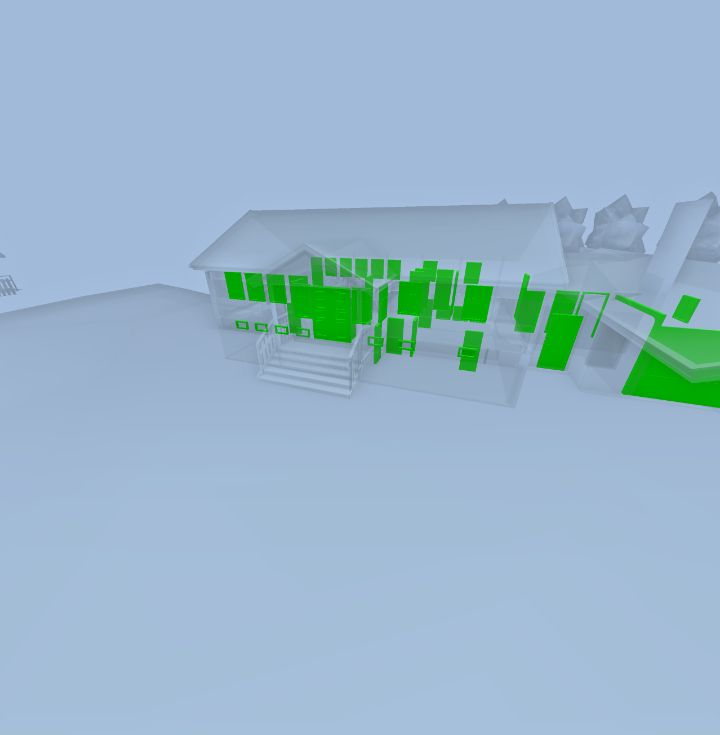
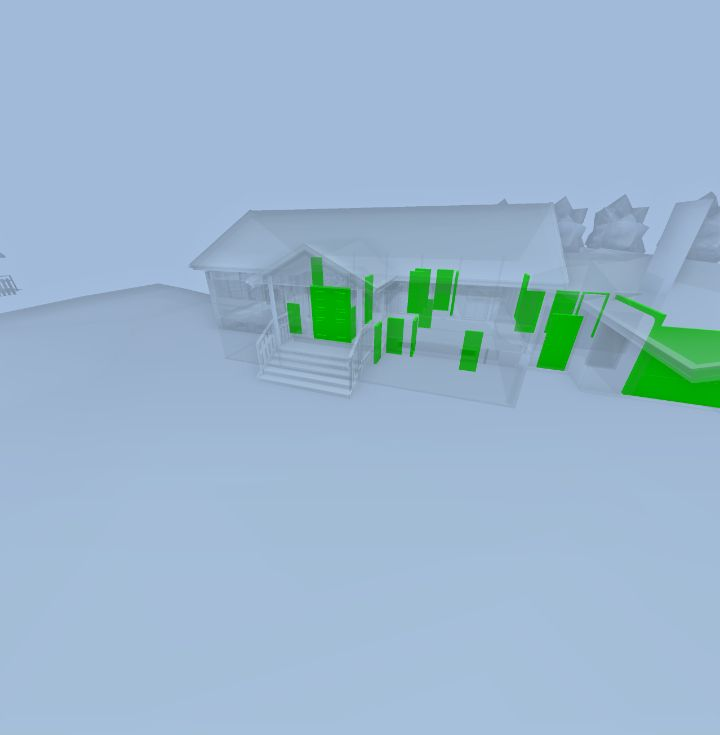

# colorCodeObjects

**Status:** 🟡 partly works · **Category:** Colour coding · [All methods](../README.md)

Meant to colour specific objects. On app.streambim.com (default flavour) it isolates them as a search, but the colours you pass are **not drawn**: the objects show in the search-highlight green. Custom colours do render for spaces with `colorCodeSpaces`.

```ts
StreamBIM.API.colorCodeObjects(colors: Record<guid, hexColor>): Promise<true>
```

## Parameters

| Name | Type | Required | Description |
|---|---|---|---|
| `colors` | `object` | yes | GUID → colour. The official README says hex; its own demo uses `"rrggbb"` without `#`. Neither form was rendered in testing. An empty object clears colour coding **and** resets the search. |

## Returns

`true`

## What StreamBIM does

`viewerController.setColorCodingByGuid(map)` (material manager: `setColorCoding(null)` then `setColorCodingByGuid(map)`), then `send("searchForObjects", guids)`, which searches `{ propKey: "@guid", operator: "in", propValue: "g1|g2|…" }`. `applySceneFilter` asks for `COLOR_CODED` mode, but `VisualModeManager.startSearchMode` only accepts that with a value → colour table (`colorCodeBy.colorCoding`, from property colour coding). With just a GUID map it logs "No color coding specified for color code visualization mode. Setting highlight visualization mode" and switches to `HIGHLIGHTED`, so objects are drawn green. (`changeSearchNodesVisualizationMode`, which would accept the GUID map on a running search, is not reachable from any widget method: `setSearchVisualizationMode` restarts the search.) Space searches take a different path, the space mesh manager, which reads the GUID map; that is why `colorCodeSpaces` works.

Call order does not help. Property colour coding first or after, colouring twice, after a space colouring, or in `ORIGINAL` mode: none drew a custom object colour (see the order example). Empty map: `setColorCodingByGuid(null)` + `resetIfcSearch`.

The beta `taskctrl` build (`/webapp/taskctrl/`, not enabled for the test account) has `colorCodeObjectsWithLegends({ data, legends })`, which also normalises colours to `#rrggbb` and stores the legends for an overlay.

## Workaround

**Objects with your own colours work in the `taskctrl` flavour** with `colorCodeObjectsWithLegends({ data, legends })`. Open the project as `https://app.streambim.com/webapp/taskctrl/#/viewer/...&forceFlavor=true` (the `forceFlavor` flag goes after the `#`). There the scene filter passes the legends table to the search, so it runs in real `COLOR_CODED` mode. Verified on 2026-11-01 with the door checklist; see [the checklist guide](../guides/checklists-and-colour-by-value.md). In the default flavour: use `colorCodeSpaces` for spaces, `colorCodeByProperty` for viewer-palette colours, or isolate one group at a time.

## Examples

#### Doors red, windows blue (renders green)

```js
const doors = await StreamBIM.API.findObjects({ key: '@kind', value: 'Door', limit: 500 });
const windows = await StreamBIM.API.findObjects({ key: '@kind', value: 'Window', limit: 500 });
const colors = {};
for (const g of doors) colors[g] = '#e5484d';
for (const g of windows) colors[g] = '#3e63dd';
await StreamBIM.API.goHome();
await StreamBIM.API.colorCodeObjects(colors);
await StreamBIM.API.zoomToSearchResult();
await new Promise((r) => setTimeout(r, 2500));
const shot = await StreamBIM.API.takeScreenshot();
await StreamBIM.API.colorCodeObjects({}); // clear
return shot;
```

<details open><summary>Output (verified 2026-11-01, 2822 ms)</summary>

```json
"[image #1 returned as image content]"
```



</details>

#### Same with "rrggbb" as in the official demo (also green)

```js
const doors = await StreamBIM.API.findObjects({ key: '@kind', value: 'Door', limit: 500 });
await StreamBIM.API.goHome();
await StreamBIM.API.colorCodeObjects(Object.fromEntries(doors.map((g) => [g, 'e5484d'])));
await StreamBIM.API.zoomToSearchResult();
await new Promise((r) => setTimeout(r, 2500));
const shot = await StreamBIM.API.takeScreenshot();
await StreamBIM.API.colorCodeObjects({});
return shot;
```

<details open><summary>Output (verified 2026-11-01, 2839 ms)</summary>

```json
"[image #1 returned as image content]"
```



</details>

#### Call order does not change it (pixel count)

```js
async function countColours() {
  const img = new Image();
  img.src = await StreamBIM.API.takeScreenshot();
  await img.decode();
  const c = document.createElement('canvas');
  c.width = 320;
  c.height = Math.round((img.naturalHeight * 320) / img.naturalWidth);
  const ctx = c.getContext('2d');
  ctx.drawImage(img, 0, 0, c.width, c.height);
  const d = ctx.getImageData(0, 0, c.width, c.height).data;
  const n = { red: 0, blue: 0, magenta: 0, cyan: 0, highlightGreen: 0 };
  for (let i = 0; i < d.length; i += 4) {
    const [r, g, b] = [d[i], d[i + 1], d[i + 2]];
    if (r > 170 && b > 170 && g < 90) n.magenta++;
    else if (g > 170 && b > 170 && r < 90) n.cyan++;
    else if (r > 170 && g < 110 && b < 110) n.red++;
    else if (b > 170 && r < 110 && g < 140) n.blue++;
    else if (g > 150 && r < 100 && b < 100) n.highlightGreen++;
  }
  return n;
}

const wait = (ms) => new Promise((r) => setTimeout(r, ms));
const doors = await StreamBIM.API.findObjects({ key: '@kind', value: 'Door', limit: 500 });
const windows = await StreamBIM.API.findObjects({ key: '@kind', value: 'Window', limit: 500 });
const map = {};
for (const g of doors) map[g] = '#ff00ff'; // magenta
for (const g of windows) map[g] = '#00ffff'; // cyan
const orders = {
  'objects only': async () => StreamBIM.API.colorCodeObjects(map),
  'property first, then objects': async () => { await StreamBIM.API.colorCodeByProperty({ propertyKey: '@kind' }); await wait(1500); await StreamBIM.API.colorCodeObjects(map); },
  'objects, then property': async () => { await StreamBIM.API.colorCodeObjects(map); await wait(1500); await StreamBIM.API.colorCodeByProperty({ propertyKey: '@kind' }); },
  'objects twice': async () => { await StreamBIM.API.colorCodeObjects(map); await wait(1500); await StreamBIM.API.colorCodeObjects(map); },
};
const result = {};
for (const [name, run] of Object.entries(orders)) {
  await StreamBIM.API.resetObjectSearch();
  await StreamBIM.API.colorCodeObjects({});
  await StreamBIM.API.goHome();
  await wait(1500);
  await run();
  await wait(3000);
  const n = await countColours();
  result[name] = { magenta: n.magenta, cyan: n.cyan, highlightGreen: n.highlightGreen };
}
await StreamBIM.API.resetObjectSearch();
await StreamBIM.API.colorCodeObjects({});
return result;
```

<details open><summary>Output (verified 2026-11-01, 23314 ms)</summary>

```json
{
  "objects only": {
    "magenta": 0,
    "cyan": 0,
    "highlightGreen": 4494
  },
  "property first, then objects": {
    "magenta": 0,
    "cyan": 0,
    "highlightGreen": 0
  },
  "objects, then property": {
    "magenta": 0,
    "cyan": 0,
    "highlightGreen": 0
  },
  "objects twice": {
    "magenta": 0,
    "cyan": 0,
    "highlightGreen": 4494
  }
}
```

</details>

## Probe results (2026-11-01)

Raw calls from `harness/tools/probe-widget-api.mjs`, each raced against a 6 s timeout:

| Case | Args | Outcome | ms |
|---|---|---|---|
| normal call | `[{"048mvnhWPDHefuPHQ5uMBr":"#ff0000"}]` | resolved `boolean` | 19 |
| clear | `[{}]` | resolved `boolean` | 11 |
