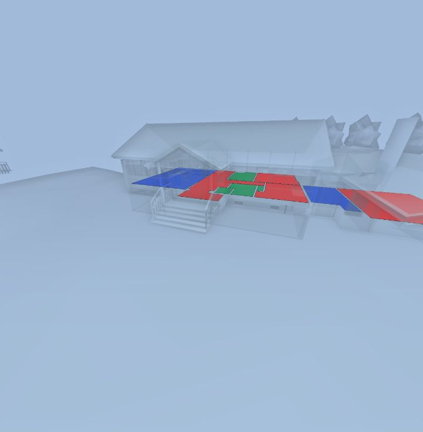
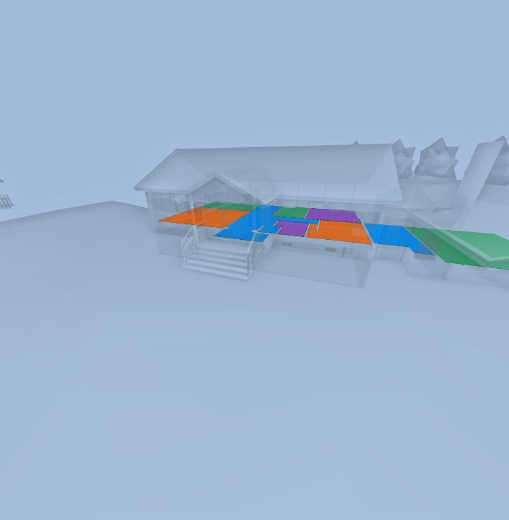

# colorCodeSpaces

**Status:** ✅ works · **Category:** Colour coding · [All methods](../README.md)

Colour IFC spaces (rooms) with **your own colours**: pass space GUIDs with a colour each. This is the custom-colour path that renders in the default webapp; other spaces and objects are faded.

```ts
StreamBIM.API.colorCodeSpaces(colors: Record<guid, hexColor>): Promise<true>
```

## Parameters

| Name | Type | Required | Description |
|---|---|---|---|
| `colors` | `object` | yes | Space GUID → `"#rrggbb"`. Only GUIDs of IfcSpace objects are used (the host adds an `@kind = Space` rule). Empty object clears colour coding and resets the search. |

## Returns

`true`: Resolves in 1–2 ms, before anything is drawn. Each call re-runs the space search, and the new colours were visible **about 190–390 ms** later (two measurement runs, 12 spaces). For stepwise animation, about 2–3 changes per second are drawn reliably. At 250 ms intervals one run drew every step and another skipped about a third. At 100 ms most steps are dropped and it flickers. Each step shows a short blank frame while the search reloads, and the last call always wins. There is no smooth colour transition: every step is a full re-colour.

## What StreamBIM does

`viewerController.setColorCodingByGuid(map)`, then `send("searchForSpaces", guids)`: one rule `{ propKey: "@guid", propValue: guid }` + `{ propKey: "@kind", propValue: "Space" }` per space. Because the search is a space search, the scene filter starts it in `COLOR_CODED` mode and the space mesh manager colours each space from the GUID map (`SceneUtils.getColorCodingFromGuid`). The same map colours spaces in the 2D map.

## Examples

#### Groups of GUIDs, one colour per group

```js
// Your data: groups of space GUIDs and the colour for each group.
const spaces = await StreamBIM.API.findObjects({ key: '@kind', value: 'Space', limit: 200 });
const groups = {
  '#e5484d': spaces.slice(0, 4),
  '#30a46c': spaces.slice(4, 8),
  '#3e63dd': spaces.slice(8),
};
// Flatten to the GUID -> colour map the API takes.
const colors = {};
for (const [color, guids] of Object.entries(groups)) for (const g of guids) colors[g] = color;

await StreamBIM.API.goHome();
await StreamBIM.API.colorCodeSpaces(colors);
await StreamBIM.API.zoomToSearchResult();
await new Promise((r) => setTimeout(r, 3000));
const shot = await StreamBIM.API.takeScreenshot();
await StreamBIM.API.colorCodeSpaces({});
return shot;
```

<details open><summary>Output (verified 2026-11-01, 3309 ms)</summary>

```json
"[image #1 returned as image content]"
```



</details>

#### Colour every space by its index

```js
const spaces = await StreamBIM.API.findObjects({ key: '@kind', value: 'Space', limit: 200 });
const palette = ['#30a46c', '#f76b15', '#8e4ec6', '#0090ff'];
await StreamBIM.API.goHome();
await StreamBIM.API.colorCodeSpaces(Object.fromEntries(spaces.map((g, i) => [g, palette[i % palette.length]])));
await StreamBIM.API.zoomToSearchResult();
await new Promise((r) => setTimeout(r, 2500));
const shot = await StreamBIM.API.takeScreenshot();
await StreamBIM.API.colorCodeSpaces({});
return shot;
```

<details open><summary>Output (verified 2026-11-01, 2785 ms)</summary>

```json
"[image #1 returned as image content]"
```



</details>

#### How fast does a colour change show?

```js
async function countColours() {
  const img = new Image();
  img.src = await StreamBIM.API.takeScreenshot();
  await img.decode();
  const c = document.createElement('canvas');
  c.width = 320;
  c.height = Math.round((img.naturalHeight * 320) / img.naturalWidth);
  const ctx = c.getContext('2d');
  ctx.drawImage(img, 0, 0, c.width, c.height);
  const d = ctx.getImageData(0, 0, c.width, c.height).data;
  const n = { red: 0, blue: 0, magenta: 0, cyan: 0, highlightGreen: 0 };
  for (let i = 0; i < d.length; i += 4) {
    const [r, g, b] = [d[i], d[i + 1], d[i + 2]];
    if (r > 170 && b > 170 && g < 90) n.magenta++;
    else if (g > 170 && b > 170 && r < 90) n.cyan++;
    else if (r > 170 && g < 110 && b < 110) n.red++;
    else if (b > 170 && r < 110 && g < 140) n.blue++;
    else if (g > 150 && r < 100 && b < 100) n.highlightGreen++;
  }
  return n;
}

const wait = (ms) => new Promise((r) => setTimeout(r, ms));
const spaces = await StreamBIM.API.findObjects({ key: '@kind', value: 'Space', limit: 200 });
const paint = (hex) => Object.fromEntries(spaces.map((g) => [g, hex]));
await StreamBIM.API.goHome();
await StreamBIM.API.colorCodeSpaces(paint('#3e63dd'));
await StreamBIM.API.zoomToSearchResult();
await wait(3000);
const runs = [];
for (let i = 0; i < 4; i++) {
  const target = i % 2 === 0 ? 'red' : 'blue';
  const t0 = performance.now();
  await StreamBIM.API.colorCodeSpaces(paint(target === 'red' ? '#e5484d' : '#3e63dd'));
  const callMs = Math.round(performance.now() - t0);
  let visibleMs = null;
  while (performance.now() - t0 < 5000) {
    const n = await countColours(); // ~40 ms per sample
    if (n[target] > 200 && n[target === 'red' ? 'blue' : 'red'] < 20) { visibleMs = Math.round(performance.now() - t0); break; }
  }
  runs.push({ to: target, callResolvedMs: callMs, visibleAfterMs: visibleMs });
}
await StreamBIM.API.colorCodeSpaces({});
return runs;
```

<details open><summary>Output (verified 2026-11-01, 4493 ms)</summary>

```json
[
  {
    "to": "red",
    "callResolvedMs": 3,
    "visibleAfterMs": 211
  },
  {
    "to": "blue",
    "callResolvedMs": 16,
    "visibleAfterMs": 355
  },
  {
    "to": "red",
    "callResolvedMs": 5,
    "visibleAfterMs": 393
  },
  {
    "to": "blue",
    "callResolvedMs": 19,
    "visibleAfterMs": 259
  }
]
```

</details>

#### Animate: flip colours every 250 ms

```js
async function countColours() {
  const img = new Image();
  img.src = await StreamBIM.API.takeScreenshot();
  await img.decode();
  const c = document.createElement('canvas');
  c.width = 320;
  c.height = Math.round((img.naturalHeight * 320) / img.naturalWidth);
  const ctx = c.getContext('2d');
  ctx.drawImage(img, 0, 0, c.width, c.height);
  const d = ctx.getImageData(0, 0, c.width, c.height).data;
  const n = { red: 0, blue: 0, magenta: 0, cyan: 0, highlightGreen: 0 };
  for (let i = 0; i < d.length; i += 4) {
    const [r, g, b] = [d[i], d[i + 1], d[i + 2]];
    if (r > 170 && b > 170 && g < 90) n.magenta++;
    else if (g > 170 && b > 170 && r < 90) n.cyan++;
    else if (r > 170 && g < 110 && b < 110) n.red++;
    else if (b > 170 && r < 110 && g < 140) n.blue++;
    else if (g > 150 && r < 100 && b < 100) n.highlightGreen++;
  }
  return n;
}

const wait = (ms) => new Promise((r) => setTimeout(r, ms));
const spaces = await StreamBIM.API.findObjects({ key: '@kind', value: 'Space', limit: 200 });
const paint = (hex) => Object.fromEntries(spaces.map((g) => [g, hex]));
await StreamBIM.API.goHome();
await StreamBIM.API.colorCodeSpaces(paint('#3e63dd'));
await StreamBIM.API.zoomToSearchResult();
await wait(3000);

let step = 0;
const timer = setInterval(() => {
  // Fire and forget: don't await, let the viewer keep up.
  StreamBIM.API.colorCodeSpaces(paint(step++ % 2 === 0 ? '#e5484d' : '#3e63dd'));
}, 250);
const frames = [];
const t0 = performance.now();
while (performance.now() - t0 < 3000) {
  const n = await countColours();
  frames.push(n.red > 100 && n.blue < 20 ? 'R' : n.blue > 100 && n.red < 20 ? 'B' : '-');
}
clearInterval(timer);
await wait(800);
await StreamBIM.API.colorCodeSpaces({});
// Collapse repeated samples: R/B = colour shown, - = blank frame while the search reloads.
return { updatesSent: step, drawn: frames.join('').replace(/(.)\1+/g, '$1') };
```

<details open><summary>Output (verified 2026-11-01, 7146 ms)</summary>

```json
{
  "updatesSent": 12,
  "drawn": "B-RB-B-BR-B-B-R-B-R"
}
```

</details>

## Probe results (2026-11-01)

Raw calls from `harness/tools/probe-widget-api.mjs`, each raced against a 6 s timeout:

| Case | Args | Outcome | ms |
|---|---|---|---|
| normal call | `[{"0A0ainOlD3Dg0Lq_ZFZGQI":"#00ff00"}]` | resolved `boolean` | 5 |
| clear | `[{}]` | resolved `boolean` | 9 |
