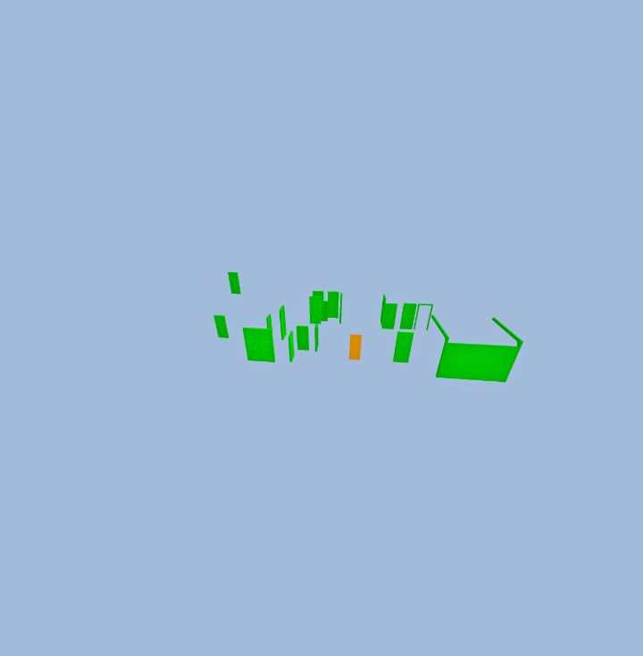

# setSearchVisualizationMode

**Status:** ✅ works · **Category:** Search · [All methods](../README.md)

How non-matching objects are drawn during a search.

```ts
StreamBIM.API.setSearchVisualizationMode(mode: "HIDDEN" | "FADED" | "ORIGINAL"): Promise<true>
```

## Parameters

| Name | Type | Required | Description |
|---|---|---|---|
| `mode` | `string` | yes | `HIDDEN` hides non-matches, `FADED` ghosts them, `ORIGINAL` draws them normally. |

## Returns

`true`: Also resolves `true` for unknown values (no validation).

## What StreamBIM does

`viewerController.send("changeOutSearchMode", { value: mode })`.

## Examples

#### Hide everything but the search result

```js
await StreamBIM.API.applyObjectSearch({ key: '@kind', value: 'Door' });
await StreamBIM.API.setSearchVisualizationMode('HIDDEN');
await StreamBIM.API.zoomToSearchResult();
await new Promise((r) => setTimeout(r, 2000));
const shot = await StreamBIM.API.takeScreenshot();
await StreamBIM.API.setSearchVisualizationMode('FADED');
await StreamBIM.API.resetObjectSearch();
return shot;
```

<details open><summary>Output (verified 2026-11-01, 2258 ms)</summary>

```json
"[image #1 returned as image content]"
```



</details>

## Probe results (2026-11-01)

Raw calls from `harness/tools/probe-widget-api.mjs`, each raced against a 6 s timeout:

| Case | Args | Outcome | ms |
|---|---|---|---|
| normal call | `["FADED"]` | resolved `boolean` | 12 |
| unknown mode | `["NOT_A_MODE"]` | resolved `boolean` | 9 |
