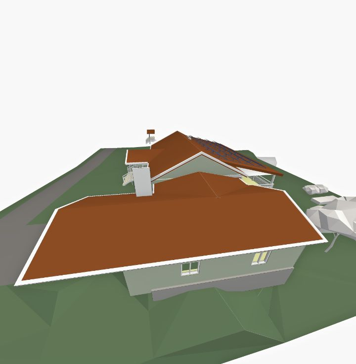

# setSkyColor

**Status:** ✅ works · **Category:** UI & styling · [All methods](../README.md)

Background colour of the 3D view.

```ts
StreamBIM.API.setSkyColor(color: string): Promise<true>
```

## Parameters

| Name | Type | Required | Description |
|---|---|---|---|
| `color` | `string` | yes | CSS colour (`"white"`, `"#dde7f3"`, `"rgb(10,20,30)"`). |

## Returns

`true`: There is no getter, so note the colour you replace.

## What StreamBIM does

`viewerController.setSkyColor(color)`.

## Examples

#### White background for a clean screenshot

```js
await StreamBIM.API.setSkyColor('white');
const shot = await StreamBIM.API.takeScreenshot();
await StreamBIM.API.setSkyColor('#a7c0e0');
return shot;
```

<details open><summary>Output (verified 2026-11-01, 113 ms)</summary>

```json
"[image #1 returned as image content]"
```



</details>

## Probe results (2026-11-01)

Raw calls from `harness/tools/probe-widget-api.mjs`, each raced against a 6 s timeout:

| Case | Args | Outcome | ms |
|---|---|---|---|
| normal call | `["#dde7f3"]` | resolved `boolean` | 5 |
