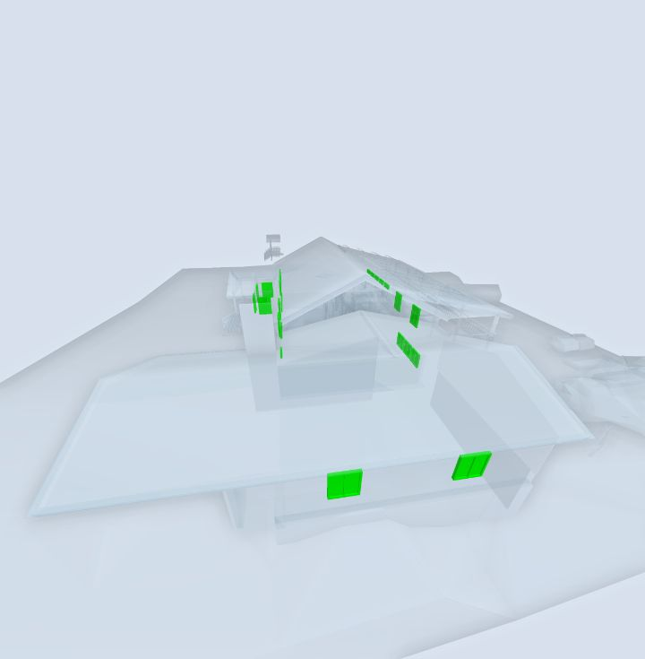

# zoomToSearchResult

**Status:** ✅ works · **Category:** Search · [All methods](../README.md)

Fit the camera to the active search result.

```ts
StreamBIM.API.zoomToSearchResult(): Promise<true>
```

## Returns

`true`: Resolves at once; the camera animates afterwards. Wait ~1 s before a screenshot.

## What StreamBIM does

`viewerController.send("zoomToSearchResult")`.

## Examples

#### Zoom to all windows

```js
await StreamBIM.API.applyObjectSearch({ key: '@kind', value: 'Window' });
await StreamBIM.API.zoomToSearchResult();
await new Promise((r) => setTimeout(r, 1200));
const shot = await StreamBIM.API.takeScreenshot();
await StreamBIM.API.resetObjectSearch();
return shot;
```

<details open><summary>Output (verified 2026-11-01, 1360 ms)</summary>

```json
"[image #1 returned as image content]"
```



</details>

## Probe results (2026-11-01)

Raw calls from `harness/tools/probe-widget-api.mjs`, each raced against a 6 s timeout:

| Case | Args | Outcome | ms |
|---|---|---|---|
| normal call | `[]` | resolved `boolean` | 8 |
